# Modu POS — Complete System Workflow Diagrams

Below is the complete Modu POS workflow in Mermaid format, covering the entire application lifecycle: platform administration, business registration, authentication, staff/member routing, branch selection, role-based authorization, POS operations, inventory, payments, loyalty, reporting, and logout.

The diagrams are separated into logical sections so you can copy them individually into GitHub Markdown, Mermaid Live Editor, or your project documentation.

## 1. Complete system overview

This is the main diagram showing how all Modu POS modules connect.

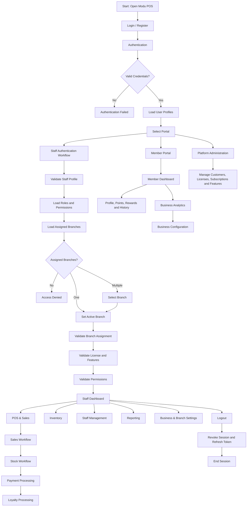

## 2. Platform administration workflow

Platform Admin controls the Modu POS platform and its business customers.

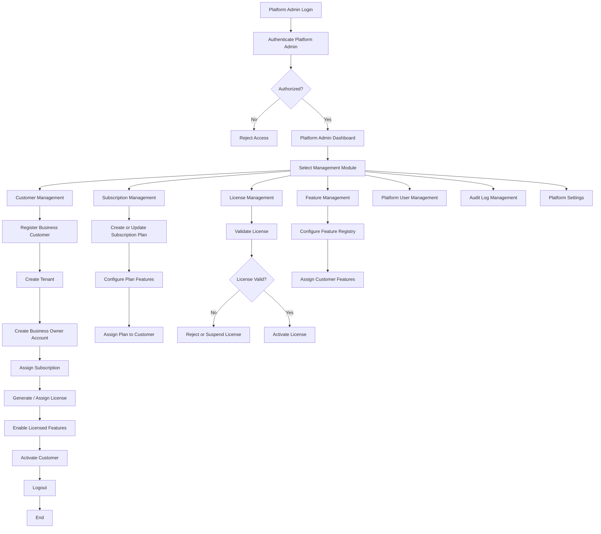

## 3. Business registration and onboarding workflow

This covers the journey from a new customer to a fully configured business.

```mermaid
flowchart TD
    A["New Business Customer"] --> B["Platform Admin Creates Customer"] --> C["Create Tenant / Customer ID"] --> D["Create Business Record"]
    D --> E["Create Business Owner User"] --> F["Assign Subscription Plan"] --> G["Generate License"] --> H["Assign Licensed Features"] --> I["Initialize Business"]
    I --> J["Business Owner Receives Invitation"] --> K["Activate Account"] --> L["Login to Business Portal"]
    L --> M["Configure Business Profile"] --> N["Configure Currency"] --> O["Configure Time Zone"] --> P["Configure Tax"] --> Q["Configure Business Settings"]
    Q --> R["Create Main Branch"] --> S["Configure Branch Settings"] --> T["Create Default Roles"] --> U["Configure Permissions"]
    U --> V["Create Products and Categories"] --> W["Assign Products to Branch"] --> X["Create Staff Accounts"] --> Y["Assign Staff to Branches"]
    Y --> Z["Assign Staff Roles"] --> AA["Initialize Inventory"] --> AB["Business Ready"]
```

## 4. Authentication and portal routing workflow

This is the central authentication workflow.

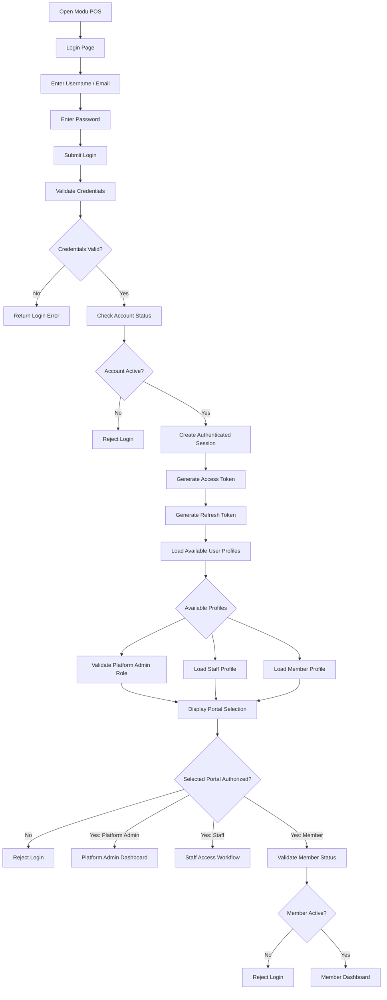

## 5. Staff authentication and branch selection workflow

This is one of the most important workflows in Modu POS.

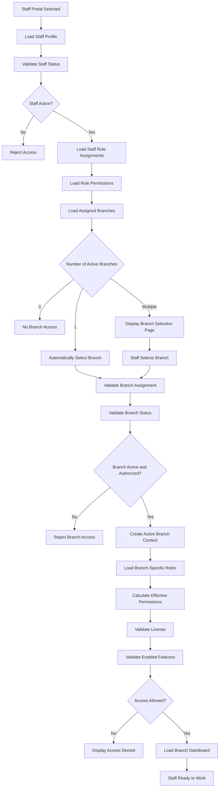

## 6. Role and permission management workflow

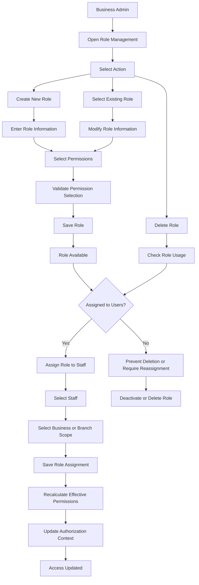

## 7. Business and branch management workflow

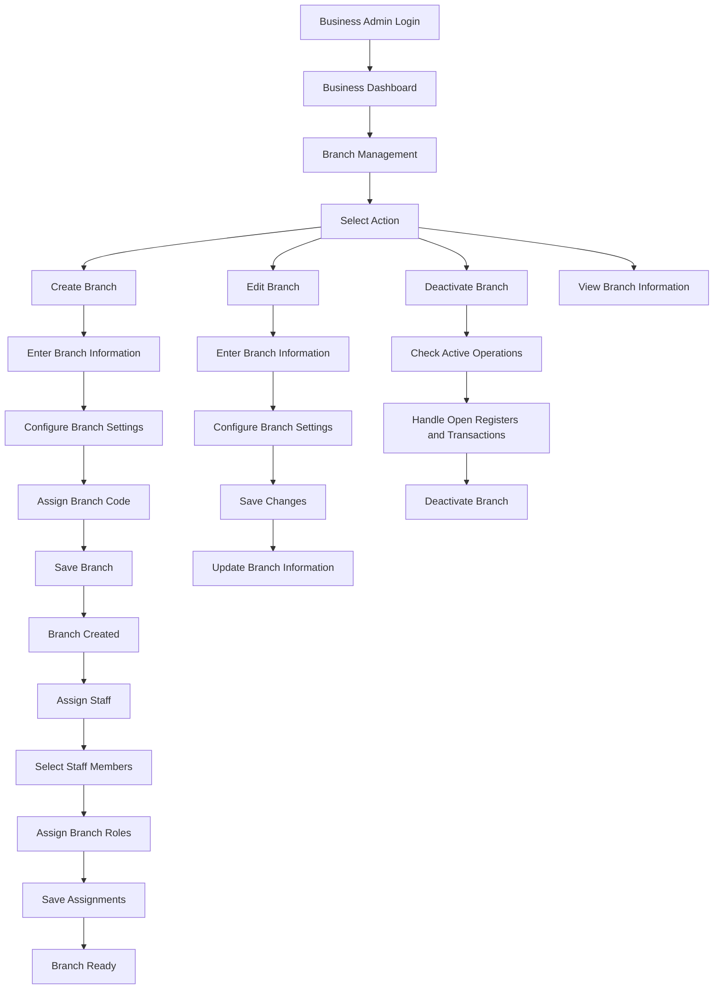

## 8. POS sales and payment workflow

This covers the main retail transaction.

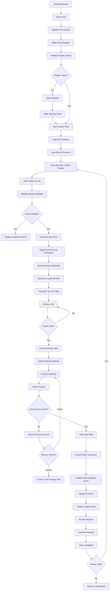

**Implementation note:** Payment processing requires special handling. Use payment idempotency keys, payment reconciliation, and a reliable transaction/outbox strategy. A payment gateway may confirm a payment even when the API times out, so retrying must not charge the customer twice.

## 9. Inventory management workflow

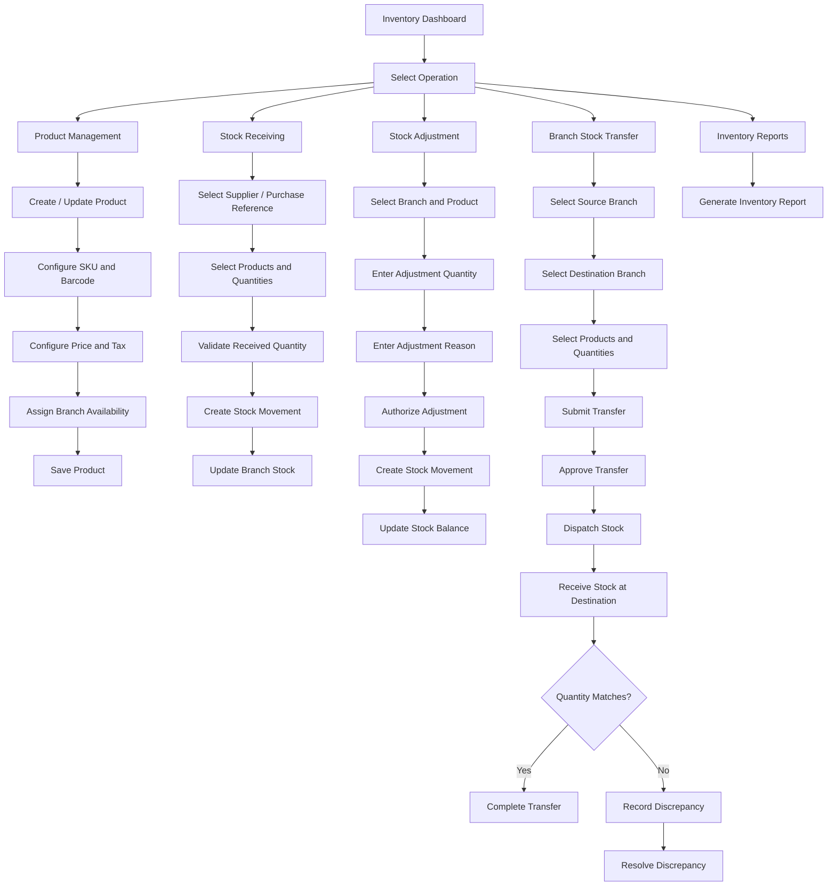

## 10. Cash register and cashier shift workflow

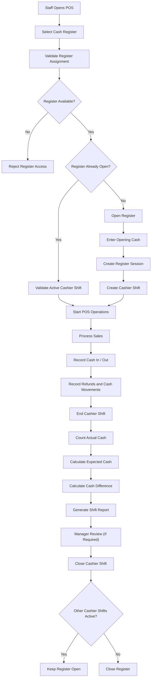

## 11. Member and loyalty workflow

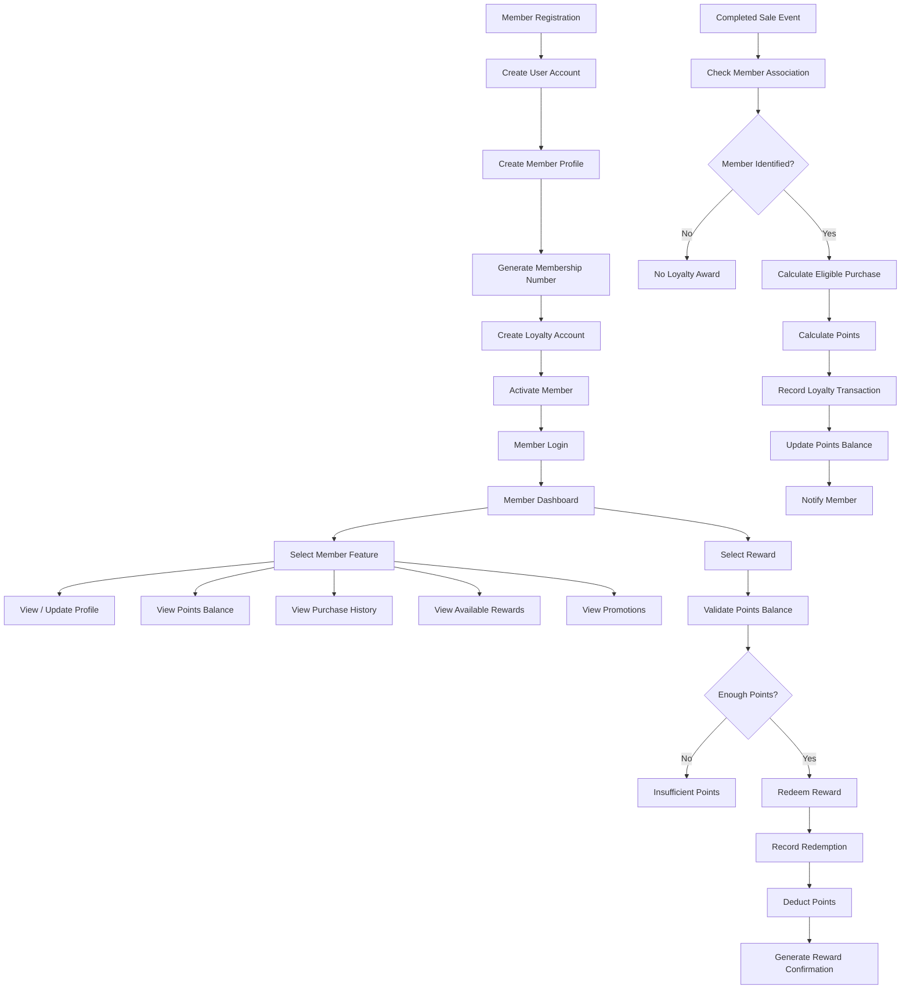

## 12. Reporting and analytics workflow

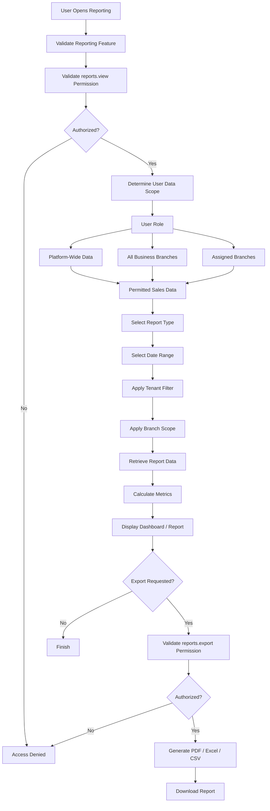

## 13. API authorization middleware workflow

This diagram shows the backend security pipeline for protected API requests.

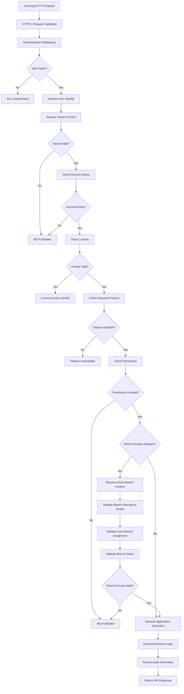

## 14. Logout and session management workflow

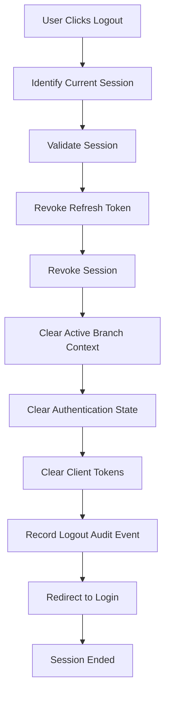

# 15. Complete Modu POS module relationship diagram

This is the architectural overview I recommend including in your technical documentation.

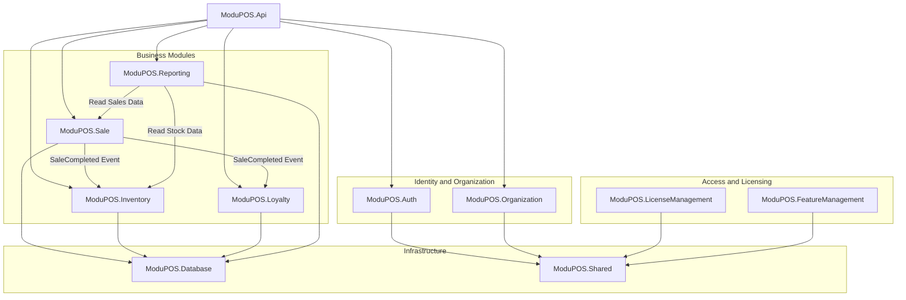

# 16. Recommended implementation sequence

The order matters because later modules depend on earlier authorization and organization foundations.

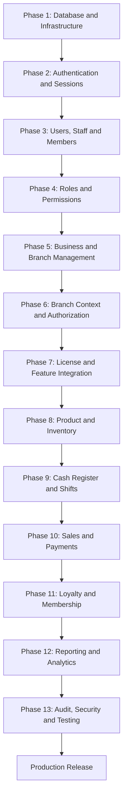

**My recommendation:** Treat sections 1, 4, 5, 6, 13, and 15 as your core architecture documentation. These define how users enter the system, how permissions work, how branches are isolated, and how all modules interact. The remaining diagrams define the business workflows that build on that foundation.
